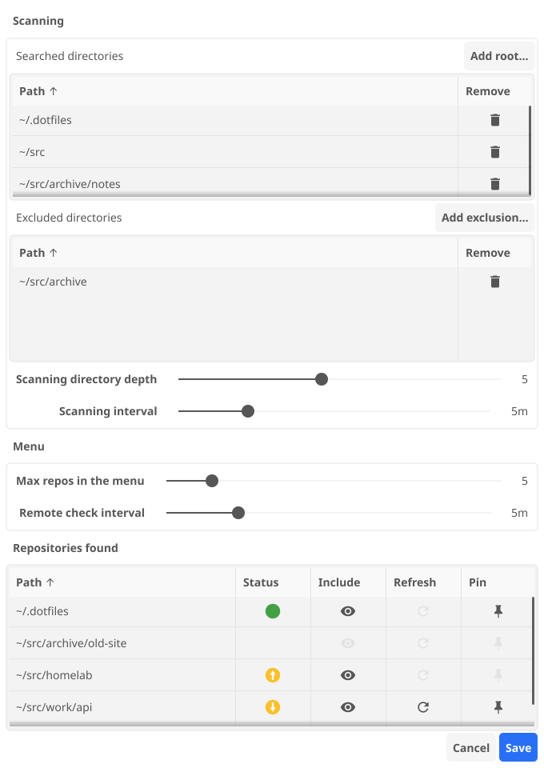

<p align="center">
  
</p>

<h1 align="center">unpushed</h1>

<p align="center">
  A tray icon that shows which of your git repositories have commits to push or pull.
</p>

The tray icon sums up every repository it finds. Its menu lists the ones you
pinned, then the ones with commits to push or pull, then the ones you worked
in most recently, each with its own icon and the number of commits ahead and
behind. Only the branch checked out in a repository's main worktree counts.

| Icon | Meaning |
| :-: | --- |
|  | In sync |
|  | Commits to push |
|  | Commits to pull |
|  | Commits to push and to pull |
|  | The last push or pull failed |

Repositories without a remote are left out.

## Using it

Clicking a yellow repository fetches, then pushes the branch or fast-forwards
it. Clicking a red one opens a terminal in the repository, so you can rebase or
merge yourself.

unpushed never fetches on its own, so a down arrow appears once you have
fetched. For repositories you mark with the refresh icon in the settings, it
asks the remote directly with `git ls-remote`, which writes nothing to the
repository. When the remote has commits you haven't fetched, the count shows
as `↓?`.

"Settings…" in the menu opens the settings window:

<picture>
  <source media="(prefers-color-scheme: dark)" srcset="docs/settings-dark.png">
  
</picture>

Every setting is also a key in the config file, see
[docs/configuration.md](docs/configuration.md).

## Installing

### NixOS and Home Manager

The flake has a package and a Home Manager module that runs unpushed as a user
service with your graphical session. `settings` takes every key of the config
file; the settings window saves your changes on top of them:

```nix
{
  inputs.unpushed.url = "github:andsens/unpushed";

  # In your Home Manager configuration
  imports = [ inputs.unpushed.homeModules.default ];
  services.unpushed = {
    enable = true;
    settings.roots."~/src".include = true;
  };
}
```

### Releases

The [releases](https://github.com/andsens/unpushed/releases) have builds for:

- **Linux** (`unpushed-Linux-x86_64`, `unpushed-Linux-aarch64`): Wayland only.
  They need `git`, and `xdg-terminal-exec` for opening terminals.
- **macOS** (`unpushed-macOS.zip`): an app for Apple silicon and Intel. It
  isn't signed, so the first launch needs a right click and "Open", or
  `xattr -d com.apple.quarantine unpushed.app`.
- **Windows** (`unpushed-Windows-x86_64.exe`): not signed either, so
  SmartScreen asks before the first run.

## How it works

- **Finding repositories:** on Linux a `find` at idle CPU and IO priority
  searches each root, elsewhere unpushed walks the directories itself.
  Excluded roots are left out of the search. A root that is a repository is
  taken as it is, so watching a fixed set of repositories means making each
  of them a root.
- **Noticing changes:** it watches `.git`, `.git/logs` and `.git/refs` of every
  repository it found, so a commit, checkout or fetch shows within a second.
- **Opening a terminal:** `xdg-terminal-exec` on Linux, which picks the
  terminal from `xdg-terminals.list`; Terminal on macOS; Windows Terminal on
  Windows, or a Command Prompt where it isn't installed.
- **Light and dark:** the settings window follows the desktop's colour scheme.

## Building

```bash
nix build
```

Without Nix, Go 1.26 and a C compiler build it from `src/`. On Linux the
Wayland, xkbcommon and GL development headers are needed as well:

```bash
go build -tags wayland,migrated_fynedo .
```

The icons and screenshots in this README are generated:

```bash
go test -tags wayland,screenshots -run Screenshots .
```

The icon scheme lives in `src/icons.go`: `Look.Color` picks the colour and
`Look.svg` draws the icon as SVG.
